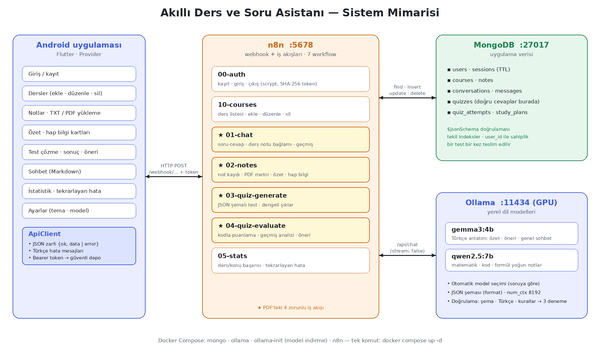
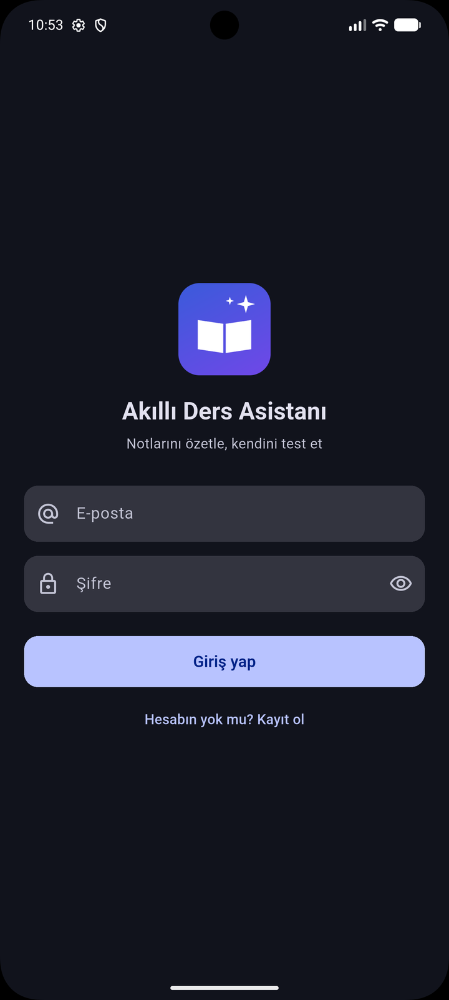
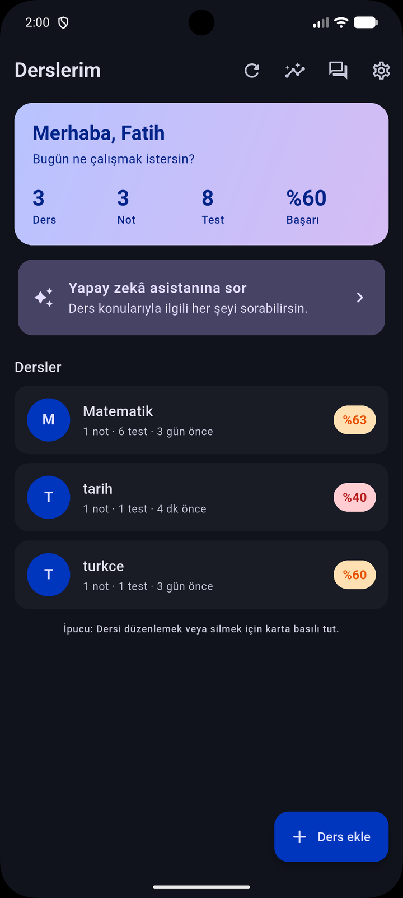
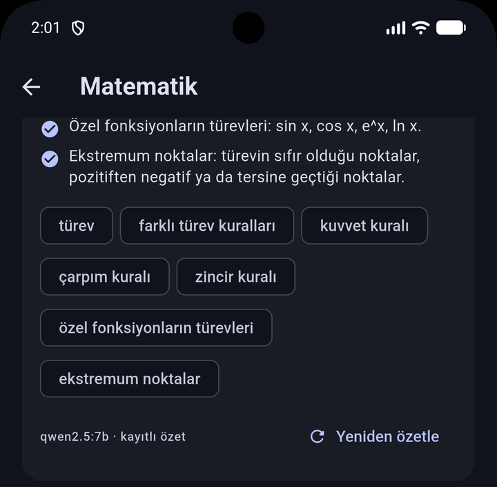
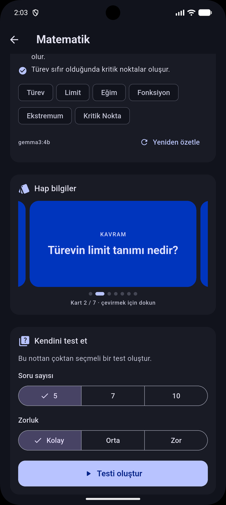
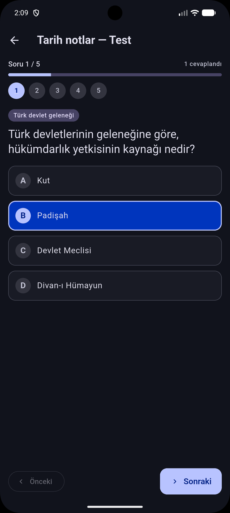
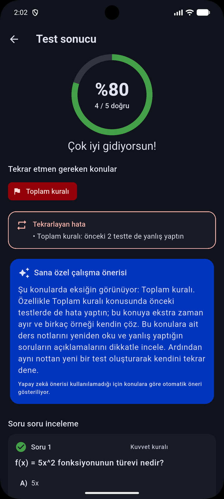
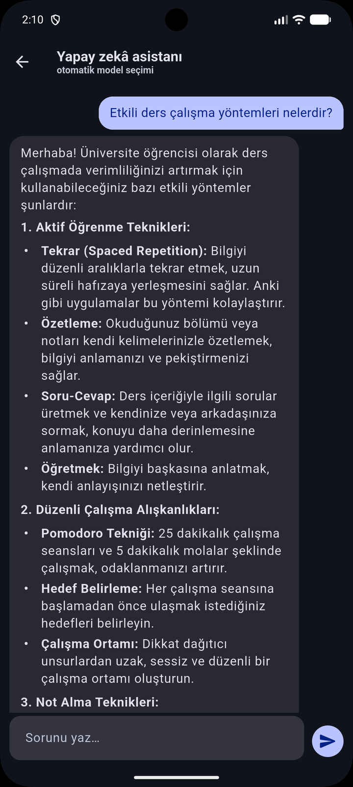
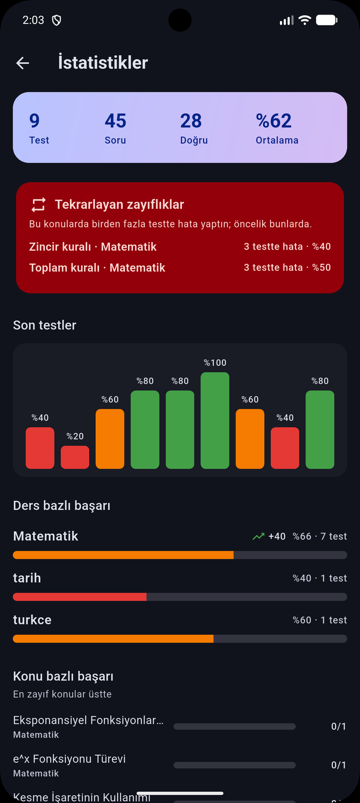
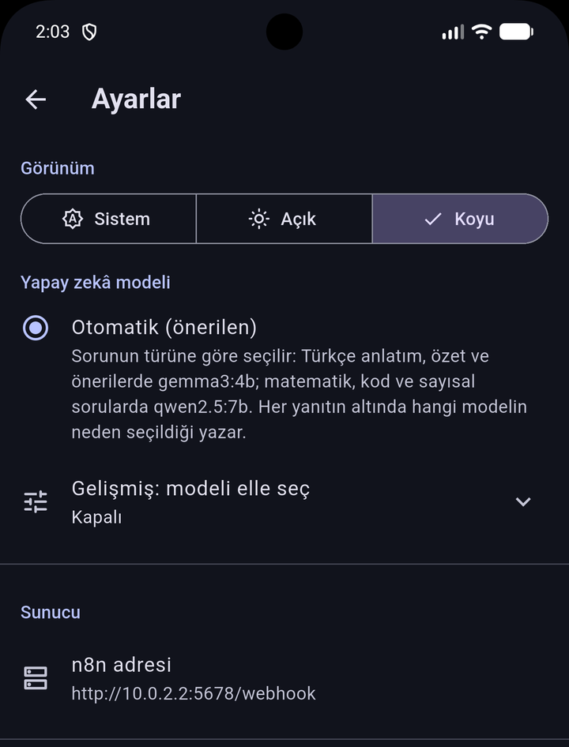

# Akıllı Ders ve Soru Asistanı

Öğrencinin ders notlarını **özetleyen**, notlardan **çoktan seçmeli test üreten**, testi **kodla puanlayan**
ve hatalarına göre — geçmiş testlerini de hesaba katarak — **kişisel çalışma önerisi** veren, tamamen
**yerel** çalışan yapay zekâ destekli mobil ders asistanı.

**Flutter** (Android) · **n8n** (webhook iş akışları) · **Ollama** (yerel LLM) · **MongoDB** · **Docker Compose**



---

## İçindekiler

- [Canlı demo senaryosu](#canlı-demo-senaryosu)
- [Ekran görüntüleri](#ekran-görüntüleri)
- [Özellikler](#özellikler)
- [Mimari ve teknik kararlar](#mimari-ve-teknik-kararlar)
- [Kurulum](#kurulum)
- [Testler](#testler)
- [Proje yapısı](#proje-yapısı)
- [Değerlendirme kriterleri eşlemesi](#değerlendirme-kriterleri-eşlemesi)
- [Bilinen sınırlamalar](#bilinen-sınırlamalar)

---

## Canlı demo senaryosu

Case dokümanındaki başarı kriteri uçtan uca çalışır:

1. Bir ders notu gönderilir (metin yapıştırma, **TXT** veya **PDF** dosyası).
2. Notun **özeti** alınır: kısa özet, ana noktalar, anahtar kavramlar ve **hap bilgi kartları**.
3. Aynı nottan **5-10 soruluk test** oluşturulur (kolay / orta / zor).
4. Testte en az bir yanlış cevap verilir.
5. Sistem puanı **kodla** hesaplar, zayıf konuları çıkarır ve yapay zekâ **kişiselleştirilmiş öneri** üretir.
   Aynı konuda önceki testlerde de hata yapıldıysa bunu ayrıca vurgular.

Adım adım çekim senaryosu: [docs/demo-senaryosu.md](docs/demo-senaryosu.md)

## Ekran görüntüleri

| Giriş | Ana sayfa | Not ve özet |
|---|---|---|
|  |  |  |

| Hap bilgi kartları | Test | Sonuç ve öneri |
|---|---|---|
|  |  |  |

| Sohbet (ders notlarıyla) | İstatistikler | Koyu mod |
|---|---|---|
|  |  |  |

## Özellikler

### Zorunlu iş akışları

| | İş akışı | Uç nokta | Öne çıkan |
|---|---|---|---|
| 1 | **Soru-cevap** | `/chat/send` | Derse bağlı sohbette o dersin notları bağlam olarak verilir; son 10 mesaj geçmişi; yanıt Türkçe ve Markdown |
| 2 | **Not özetleme** | `/notes/summarize` | JSON şemalı özet + hap bilgi kartları; özet saklanır, tekrar istenirse model çağrılmaz |
| 3 | **Test oluşturma** | `/quizzes/generate` | Case dokümanındaki şema; doğrulama; **doğru cevap istemciye gönderilmez**; şıklar dengeli dağıtılır |
| 4 | **Performans değerlendirme** | `/quizzes/submit` | Puanlama kodla; zayıf + **tekrarlayan** konular; yapay zekâ önerisi, olmazsa kural tabanlı yedek öneri |

### Bonus özellikler (case dokümanındaki listeden)

| Bonus | Durum |
|---|---|
| Sohbet geçmişini kullanıcı bazında saklama | ✅ Sohbet listesi, geçmiş, derse göre filtre |
| Ders bazlı sohbet ve başarı istatistikleri | ✅ İstatistik ekranı: ders ve konu bazlı başarı, son testler, gelişim eğilimi |
| Kullanıcı bazlı yetkilendirme | ✅ Kayıt/giriş, scrypt şifre özeti, token; her sorgu kullanıcıya göre filtrelenir |
| Farklı Ollama modelleri arasında seçim | ✅ **Otomatik model seçimi** + Ayarlar → Gelişmiş'te elle seçim |
| PDF yükleme | ✅ n8n *Extract From File* ile metin çıkarma, temizleme; bozuk / taranmış PDF için ayrı hata |
| RAG ile yalnızca notlara dayalı yanıt | Kısmen: derse bağlı sohbette dersin notları bağlam olarak verilir |
| Haftalık çalışma programı | ⏳ Planlandı (veri modeli hazır) |

### Ek özellikler

- **Geçmişe dönük hata analizi:** aynı dersin önceki testlerinde aynı konuda hata yapıldıysa sonuç ekranında
  "Tekrarlayan hata" olarak gösterilir, öneri bu konular için farklı bir çalışma yöntemi önerir; İstatistik
  ekranında "3 testte hata" gibi tekrarlayan zayıflıklar listelenir. Model konu adlarını her testte farklı
  yazabildiği için ("Zincir kuralı" / "Zincir Kuralı uygulaması") konular normalize edilerek eşleştirilir.
- **Hap bilgi kartları:** özetle aynı yapay zekâ çağrısında üretilir; dokununca çevrilen kartlar.
- **Ders ve not yönetimi:** ders adını düzeltme, dersi tüm notları, testleri ve sohbetleriyle silme; dersi silmeden tek bir notu testleri ve sonuçlarıyla silme (onaylı).
- **Uzun not desteği:** 15.000 karakter sınırını aşan kısım kırmızı gösterilir; tek dokunuşla kırpılır.
- **Koyu mod:** Sistem / Açık / Koyu.

## Mimari ve teknik kararlar

```
Flutter ──HTTP/JSON + Bearer token──▶ n8n (7 workflow) ──▶ MongoDB (9 koleksiyon)
                                                     └──▶ Ollama (/api/chat)
```

Flutter yalnızca n8n webhook'larıyla konuşur; veritabanını ve modeli hiç görmez. Uç noktaların tamamı ve
JSON yapıları: **[docs/API.md](docs/API.md)**.

### Neden MongoDB?

Case dokümanı SQLite veya PostgreSQL önerse de **şirketten gelen talimatla veri katmanı MongoDB'dir.**
İlişkisel veritabanının sağladığı güvenceler MongoDB'de şu şekilde karşılandı:

- **Şema doğrulaması** (`$jsonSchema`): hatalı belge veritabanı seviyesinde reddedilir
  (ör. bir soruda tam 4 şık, doğru cevap indeksi 0-3, e-posta küçük harf).
- **Tekil indeksler:** aynı e-posta, aynı kullanıcıda aynı ders adı, bir testin ikinci kez teslimi engellenir.
- **TTL indeksi:** süresi dolan oturumlar kendiliğinden silinir.
- **Sahiplik:** her sorgu `user_id` ile filtrelenir; başka kullanıcının verisi "bulunamadı" (404) döner.
- Test soruları doğru cevaplarıyla `quizzes` belgesine **gömülüdür**; istemciye giden yanıttan çıkarılır.

### Yapay zekâ çıktısına güvenmemek

Küçük yerel modeller zaman zaman bozuk JSON, eksik alan veya Türkçe yerine Çince karakter üretir.
Bu yüzden her yapay zekâ çağrısı aynı desenle korunur:

1. **Sıkı prompt** (yalnızca Türkçe, uzunluk, biçim kuralları) ve Ollama `format` ile **JSON şeması**.
2. **Koddan doğrulama:** şema, Türkçe dışı karakter (Çince/Japonca/Korece/Kiril), içerik kuralları
   (ör. doğru cevap şıklardan biri mi, soru cevabını kendi içinde veriyor mu, öneri zayıf konuları anıyor mu).
3. Kural bozulursa **en fazla 3 deneme**; sonra anlamlı bir hata (`502 AI_BAD_OUTPUT`) veya
   değerlendirmede kural tabanlı **yedek öneri** — puan her durumda döner.
   Tüm yapay zekâ çağrılarında 3. deneme **diğer modelle** yapılır (yedek model; sohbette yanıtın altında `yedek model` yazar).
   Testte model istenenden **2 fazla soru** üretir; kurala uymayan sorular tek tek elenir, test bütünüyle reddedilmez.
   Uzun bir sohbet yanıtına yalnızca birkaç yabancı karakter kaçmışsa yanıt çöpe atılmaz, o karakterler silinir.
4. Ollama kapalıysa `503 AI_UNAVAILABLE` ve kullanıcıya Türkçe mesaj.

Test sorularında doğru cevabın konumu **dengeli dağıtılır** (her 4 soruda A/B/C/D birer kez):
modeller doğru cevabı hep ilk şıkka koyma eğiliminde olduğundan rastgele karıştırma yeterli değildir.

### Otomatik model seçimi

8 GB VRAM'de iki model denendi; ikisinin de güçlü ve zayıf yanları var
([docs/model-karsilastirma.md](docs/model-karsilastirma.md)). Kullanıcıya teknik bir tercih yüklemek yerine
iş akışı soruya göre seçer:

| İş | Model | Neden |
|---|---|---|
| Özet, öneri, genel sohbet | `gemma3:4b` | Türkçesi daha doğal, hızlı |
| Matematik / kod / sayısal soru, formül yoğun nottan test | `qwen2.5:7b` | Akıl yürütme ve yapılandırılmış çıktıda güçlü |

Her sohbet yanıtının altında modelin adı ve **seçilme nedeni** yazar (ör. `qwen2.5:7b · matematiksel ifade`).
Ayarlar → Gelişmiş'ten model elle de seçilebilir.

### Güvenlik

- Şifreler **scrypt** ile tuzlanarak özetlenir; oturum anahtarının veritabanında yalnızca **SHA-256 özeti** tutulur.
- Token Android Keystore destekli **güvenli depoda** saklanır; 401 alındığında oturum kapanır ve giriş ekranına dönülür.
- `.env` git'e eklenmez; örnek değerler [.env.example](.env.example) dosyasındadır.

### n8n iş akışları koddan üretilir

Workflow JSON'ları elle değil, [tools/n8n-gen](tools/n8n-gen) altındaki Python üreticilerle oluşturulur;
Code düğümlerinin JavaScript'i ayrı dosyalarda durur. Bu sayede her değişiklik **simülatörde 145 senaryoyla**
otomatik test edilir (bkz. [Testler](#testler)).

## Kurulum

### Gereksinimler

- Windows 10/11 + **Docker Desktop** (WSL 2) — Linux/macOS'ta da çalışır
- NVIDIA GPU önerilir (geliştirme: RTX 4060 8 GB VRAM, 32 GB RAM); GPU yoksa Ollama CPU'da yavaş çalışır
- **Flutter SDK** ve Android Studio (emülatör)

### 1. Backend

```powershell
Copy-Item .env.example .env        # MONGO_PASSWORD ve N8N_ENCRYPTION_KEY değerlerini değiştirin
docker compose up -d               # mongo, ollama, ollama-init (modelleri indirir), n8n
docker compose ps                  # mongo ve ollama "healthy", n8n "running"
docker compose logs -f ollama-init # model indirme ilerlemesi (ilk seferde ~8 GB)
```

### 2. n8n iş akışları

1. `http://localhost:5678` → sahip hesabını oluşturun.
2. **Credential → MongoDB** ekleyin: Configuration Type *Connection String*,
   `mongodb://<MONGO_USER>:<MONGO_PASSWORD>@mongo:27017/?authSource=admin`, Database `asistan`,
   adı **Asistan Mongo**.
3. Credential'ın kimliğini (adres çubuğunun sonundaki değer) workflow dosyalarına yazın:
   ```powershell
   powershell -ExecutionPolicy Bypass -File scripts\set-credential-id.ps1 -Id <KIMLIK>
   ```
4. `n8n/workflows` altındaki 7 dosyayı içe aktarın (**+ → Workflow → ⋯ → Import from File**) ve her birini **Publish** edin.

### 3. Doğrulama

```powershell
powershell -ExecutionPolicy Bypass -File scripts\test-auth.ps1        # 8 senaryo
powershell -ExecutionPolicy Bypass -File scripts\test-chat.ps1        # dersler + soru-cevap
powershell -ExecutionPolicy Bypass -File scripts\test-notes-quiz.ps1  # canlı demo senaryosu
powershell -ExecutionPolicy Bypass -File scripts\test-pdf.ps1         # PDF yükleme (docs/ornek-notlar/turev.pdf)
```

### 4. Mobil uygulama

```powershell
cd mobile
flutter pub get
flutter run                        # Android emülatörü: sunucu adresi 10.0.2.2:5678
```

Gerçek telefonda: `flutter run --dart-define=API_BASE=http://<bilgisayarın-IP>:5678/webhook`
ve Windows Güvenlik Duvarı'nda 5678 numaralı TCP portuna izin verin.

## Testler

| Katman | Nasıl | Kapsam |
|---|---|---|
| Uçtan uca (gerçek sistem) | `scripts/*.ps1` | Kayıt, giriş, dersler, sohbet, not → özet → test → değerlendirme, PDF yükleme; hata kodları |
| İş akışı simülatörü | `node tools/n8n-gen/test/run-all.mjs` | 145 senaryo: workflow JSON'ları gerçek Code düğümü koduyla, bellek-içi MongoDB ve sahte Ollama üzerinde çalıştırılır (yetki, sahiplik, yeniden deneme, yedek öneri, dengeli şıklar, otomatik model, geçmiş analizi, ders ve not silme, PDF) |
| Flutter birim testleri | `cd mobile && flutter test` | JSON → model dönüşümleri, Türkçe biçimlendirme |

## Proje yapısı

```
akilli-asistan/
├── docker-compose.yml        # mongo · ollama · ollama-init · n8n
├── .env.example
├── mongo/init/01-init.js     # koleksiyonlar, şema doğrulamaları, indeksler
├── n8n/workflows/            # 7 workflow (içe aktarılacak JSON)
├── mobile/                   # Flutter uygulaması
│   └── lib/{api,state,screens,widgets,utils}
├── scripts/                  # uçtan uca testler, credential yardımcı betiği
├── tools/n8n-gen/            # workflow üreticileri, Code düğümü JS'leri, simülatör
└── docs/                     # API, mimari diyagram, model karşılaştırması, demo senaryosu, örnek not PDF
```

## Değerlendirme kriterleri eşlemesi

| Kriter | Puan | Bu projede |
|---|---|---|
| Flutter arayüzü ve kullanıcı deneyimi | 15 | 11 ekran, her ekranda yükleniyor / hata / boş durumları, Markdown sohbet, koyu mod, özgün ikon |
| Flutter – n8n API entegrasyonu | 15 | Tek tipli API istemcisi, ortak JSON zarfı, Türkçe hata mesajları, yapay zekâ çağrılarında uzun zaman aşımı, 401'de otomatik çıkış |
| n8n workflow geliştirme | 20 | 7 workflow, 18 uç nokta; her durum için ayrı ve açık durum kodu; koddan üretim + simülatör testi |
| Ollama entegrasyonu ve prompt tasarımı | 20 | JSON şeması, doğrulama + 3 deneme, Türkçe denetimi, otomatik model seçimi, geçmişe dayalı öneri |
| Docker ve Docker Compose | 15 | Tek komutla kurulum, sağlık kontrolleri, GPU, otomatik model indirme, MongoDB başlangıç betiği |
| Hata yönetimi ve veri işleme | 10 | Şema doğrulaması (veritabanı + kod), 400/401/404/409/422/502/503 ayrımı, yedek öneri, sahiplik kontrolleri |
| Dokümantasyon ve sunum | 5 | Bu README, API sözleşmesi, mimari diyagram, model karşılaştırması, demo senaryosu |

## Bilinen sınırlamalar

- Yerel geliştirme kurulumudur: HTTP (HTTPS değil), tek makine; üretim için TLS, hız sınırlama ve yedekleme gerekir.
- Küçük yerel modeller her zaman kusursuz değildir; doğrulama ve yeniden deneme hataların çoğunu kullanıcıya yansıtmadan yakalar, ama içerik doğruluğu garanti değildir.
- Haftalık çalışma programı henüz eklenmedi.
- PDF'ten yalnızca seçilebilir metin okunur; taranmış (resim) PDF'ler için OCR yoktur.
